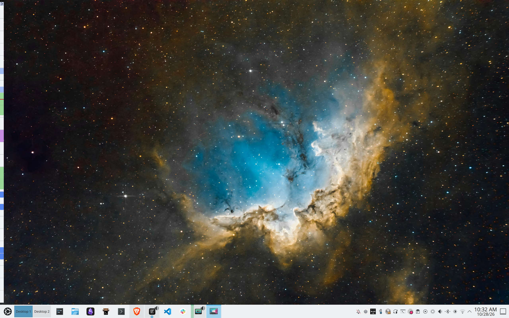
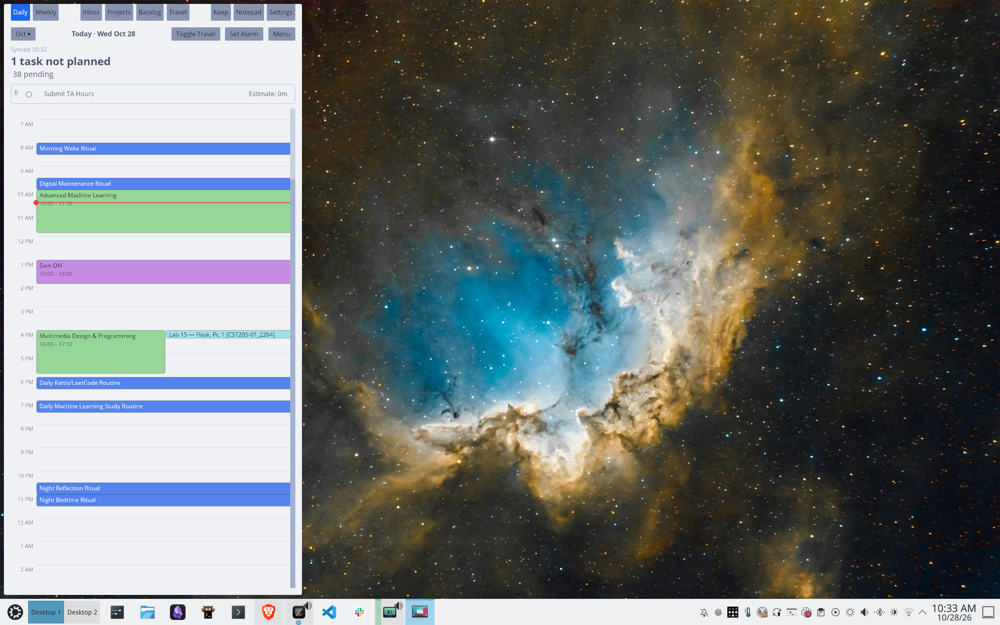
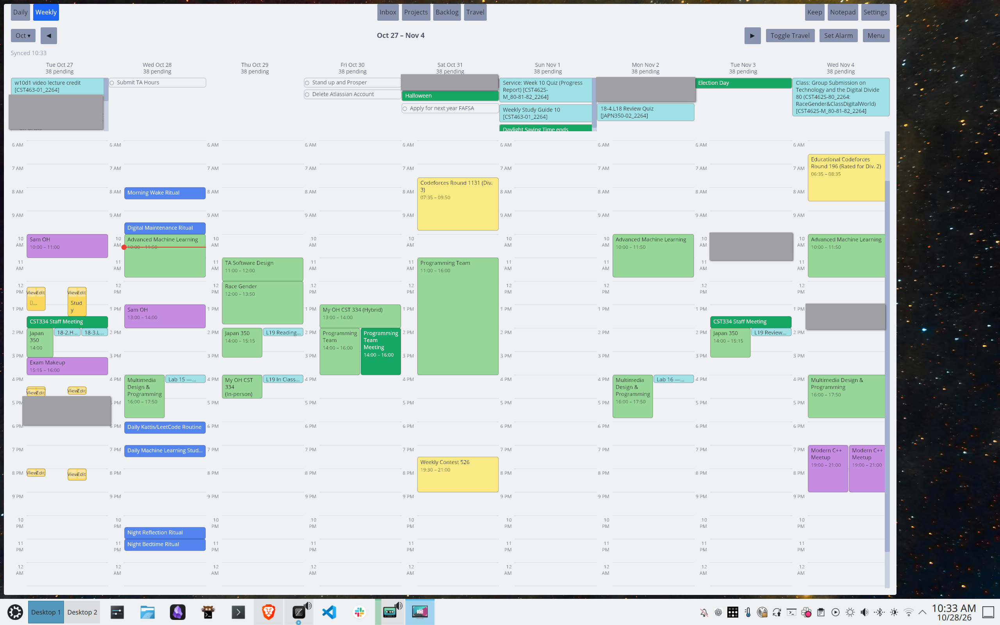

# TimeSlay

Slay the day with TimeSlay.

There's currently two implementations:

- An [Iced](https://iced.rs) desktop application.
- A [Dioxus](https://dioxuslabs.com) mobile and desktop application.

## Preview

I love docked mode. Your day is always at a glance. You can still hover over, and edit, events and tasks from this mode.



A larger panel to plan and read the day.



Same for the week. Notice how yesterday can be included in this view.



## Features

- Stays out of your way during work, but is easily accessible when needed.
	- Toggle between "docked" and "panel" mode as shown above (<kbd>Meta+J</kbd>).
	- Toggle between hiding and showing the app (<kbd>Meta+Shift+J</kbd>).
- Intuitive to use (WIP).
- View your time:
	- Day view
	- Week view
	- Month view
	- Custom views for week and month view. (TODO)
		- Based on query; omit private event details. (TODO)
- Manage your time:
	- Events
		- Integrates with guest/event/RSVP going/not going feature (TODO)
		- Integrates with meeting software like Zoom and Google Meet. (TODO)
		- Uses location data to pad event with travel time. (WIP)
	- Time blocks
		- Assign tasks to time blocks.
		- Brain dump.
		- Pomodoro timer in the time block view: configurable work/break lengths, separate elapsed totals, and automatic task stop/resume at phase boundaries. Task tracking also works independently. Pause freezes only the Pomodoro clock; Reset clears its totals. The shared timer continues across blocks and while the popup is closed.
	- Habits
		- Allow "floating" habit, so it can be done anytime during the week/month, etc. or show it on a day +- 3 days etc. Or can make it hard deadline (no +), and have it be greedy (TODO)
	
- Manage tasks:
	- Create tasks:
		- With Todoist-like syntax and voice input. (TODO)
		- From Gmail URLs
		- Within Slack (WIP)
	- Triage tasks so they're discoverable later.
	- Workflow to manage tasks not done in days prior (TODO)
	- Send low-priority tasks to a backlog.
- Projects (TODO)
	- View the events, tasks, and notes for any project. (TODO)
	- List view, kanban view, calendar view (TODO)
	- During events and tasks associated with a project, easily launch and position the apps/windows necesssary to do the work. (TODO)
- Objectives & Goals (TODO)
	- Tasks, certain amount of time per project. (TODO)
	- Day, week, month, quarter, year. (TODO)
	- SMART goals (TODO)
- Uses Google Calendar, Tasks, and Drive to store events, tasks, and app data.

## Usage

```sh
# Iced desktop app.
cargo run -p time-slay --release

# Dioxus desktop app (minimal).
cargo run -p time-slay-dioxus

# Dioxus mobile app (minimal).
./scripts/build-android.sh
```

## Next Up

- Better UI (shadcdn/pure.css)
- Having the dock take up space on dekstop
- File attachments/file:// links & notes integration for event/task/habit etc.
- Waiting for reply email (waiting-for tag), once reply, put back in to-do but if not, wait until date to do so. or AI to detect.
- alt+tab proper icon does not show up

### Stretch

- For everywhere in interface, there should be a new task button
- Command palette
	- Global search
- Reminders (use Google Calendar)
- Logs/instant local field changes/lock field/no waiting for network in interface/show there in queue/undo
- Analytics of time spent
- People/contacts
- Start/shutdown/review rituals for day/week/month
- Offline write queue
- Eisenhower matrix (TODO)
- Theme/project days (TODO)

## Design Constraints

The design of this app is, in part, constrainted by the fact that:

- Google Task API does not allow for reading/writing the time of dday of a due date or deadline (only day).
- Google Task API does not allow writing the deadline field (only due date).
- Google Keep API cannot be used by non-workspace users.
- Integrates only with the KDE Plasma desktop environment on Linux.
